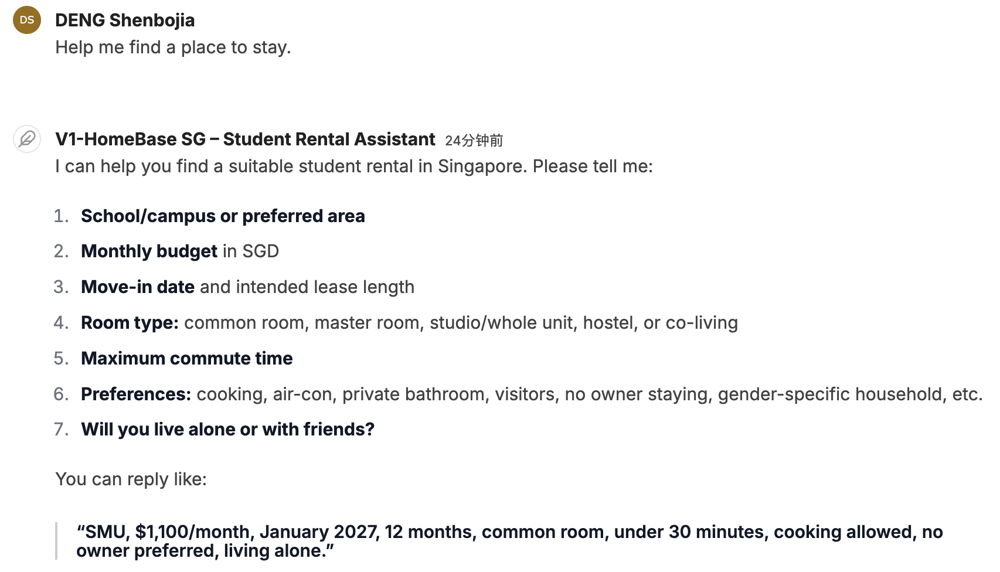
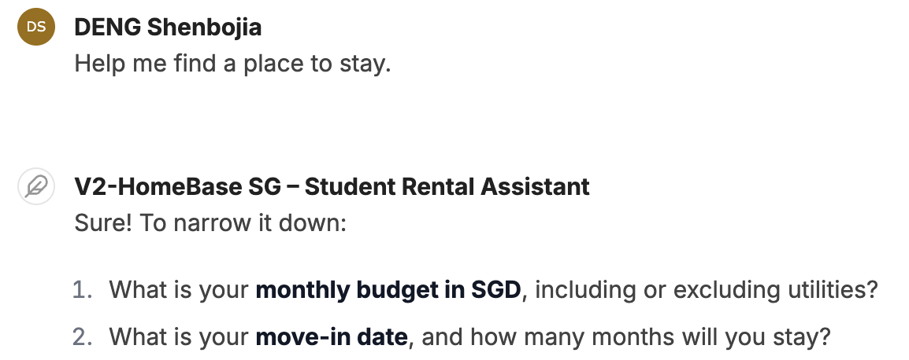

# HomeBase SG – AI Rental Assistant for SMU Students

DS602 agent-building assignment (Lesson 9–10, *Solving a business problem with an AI agent*), built in **SMU AI Studio**.

HomeBase SG helps international students at SMU find a room to rent in Singapore. Listing sites help students *search*; nobody helps them *decide* and *stay safe*. The agent learns the student's needs through conversation, compares three clearly different options, explains the trade-offs, and checks for scams and contract problems before anything is paid or signed.

## Repository contents

| Folder | What's inside |
|---|---|
| [`agent/`](agent/) | Instructions V1 (baseline) and V2 (improved), the two skills, platform settings |
| [`knowledge/`](knowledge/) | Knowledge file uploaded to the agent: room types, rent table by area, budget tips, viewing & contract checklists, scam red flags |
| [`testing/`](testing/) | 8 test cases, V1 vs V2 results, screenshots |
| [`presentation/`](presentation/) | Beamer slides (LaTeX source + PDF) |
| [`scripts/`](scripts/) | Bilingual (EN/中文) presentation scripts: with slides, and live demo without slides |

## Agent design

| Framework (Lesson 9) | HomeBase SG |
|---|---|
| Objective & instructions | Help SMU students choose an area and room type within budget; output a 3-option comparison and an action plan |
| Skills, tools & knowledge | `compare-rental-options`, `scam-and-contract-check`; web search + file search; researched rent data |
| Guardrails & permissions | No invented prices or listings; never pays or signs; no legal advice; student rentals only |
| Human review & approval | Student confirms before paying or signing; contracts, legal disputes and scams go to SMU student services or official help |

## Results

V1 (one-line instruction, no skills) fully passed **3/8** tests (5 partial). V2 passed **8/8**. Model, tools, knowledge file, prompts and follow-up answers were identical, so the difference comes from the design. Details in [`testing/results.md`](testing/results.md).

| Test 3 – "Help me find a place to stay." | |
|---|---|
| V1: 7 questions at once | V2: 2 questions |
|  |  |

## Limitations

- Rents are estimates, not live listings
- V2 sometimes asks two rounds of questions before giving options
- Rent figures did not always match the knowledge file
- Source links sometimes display wrongly or are missing
- Not legal advice; built for SMU students only

## Data sources

Rent data in the knowledge file: Hozuko *Singapore Room Rent Snapshot* (June 2026, ~2,000 listings) and Zrooom *Cost of Renting in Singapore* (2026). Rules (HDB, URA, IRAS, CEA) change: always check official websites.

## Building the slides

Upload the `presentation/` folder to Overleaf (or run `pdflatex homebase_sg.tex` twice inside it). Uses the Metropolis Beamer theme.
